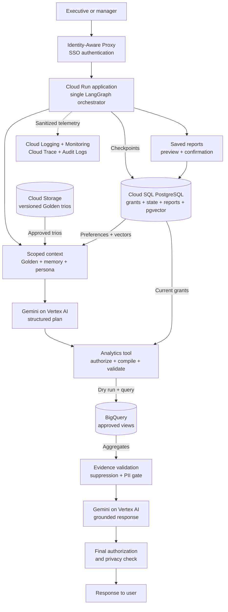
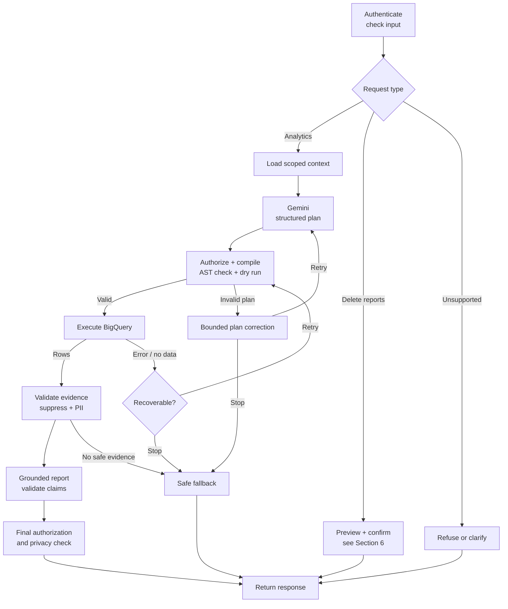
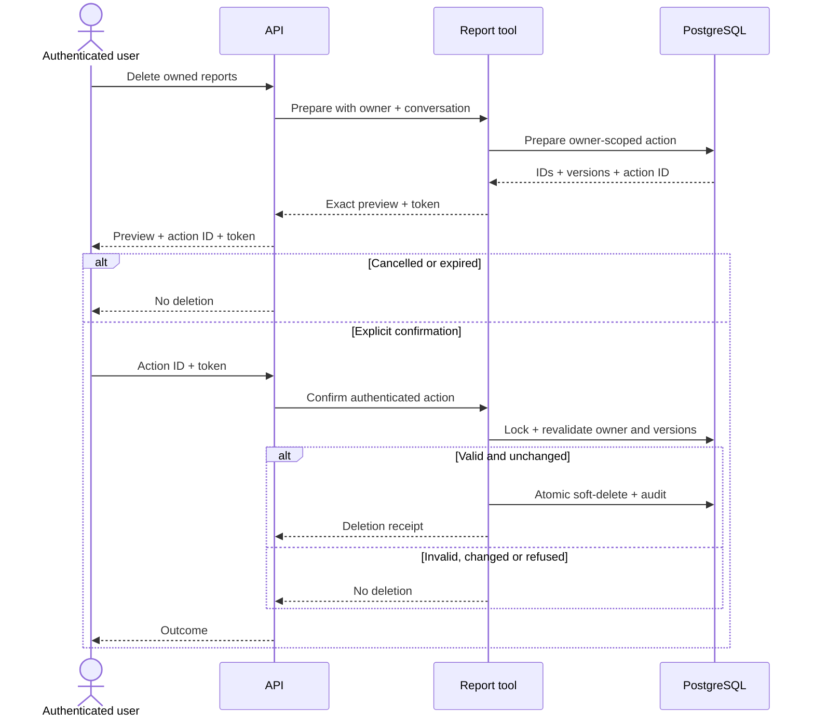

# Retail Analytics Agent — Architecture Proposal

**Status:** proposed production design; Section 11 describes the implemented prototype. [README.md](README.md) covers setup, CLI examples, and tests. **Reading time:** approximately 10–15 minutes.

## 1. Overview and key decisions

Use one Python application on Cloud Run for simple deployment and scaling, with a **single LangGraph orchestrator and deterministic tools**. Gemini plans and explains; application code controls identity, brand permissions, SQL, privacy, and deletion. BigQuery calculates metrics; PostgreSQL stores state.

| Choice | Why it fits and what it costs |
|---|---|
| GCP and Vertex AI Gemini | Keep model access and warehouse operations under GCP identity and governance. Pin an evaluated, generally available Gemini Flash model and settings; check its [lifecycle](https://docs.cloud.google.com/vertex-ai/generative-ai/docs/learn/model-versions) before deployment. |
| LangGraph | Make state, routing, retries, and confirmation steps explicit. Persistent checkpoints support conversations without multiple agents. |
| Structured plans and a SQL compiler | Generate dynamic queries through tested templates. This makes security testable but limits the supported analyses (Section 4). |
| Cloud SQL PostgreSQL with pgvector | Keep transactions, state, and retrieval in one database. This avoids a separate vector service but adds a fixed database cost. Check [extension support](https://docs.cloud.google.com/sql/docs/postgres/extensions). |
| Cloud Storage and a scheduled indexing job | Version and review Golden Knowledge before publication. Hourly updates avoid the complexity of streaming ingestion. |

### Scope and business definitions

Assume one retailer, tens of concurrent executives initially, and an existing warehouse ingestion process.

**Assignment clarification:** managers can analyze their assigned **brands**; the CEO can analyze all brands. The dataset's `users` table contains shoppers, not employees. CEO access does not bypass privacy rules or report ownership.

Use `orders`, `order_items`, `products`, and `users` from `bigquery-public-data.thelook_ecommerce`, with retailer-owned equivalents in production. Verify schemas, statuses, and dataset location during setup.

Join items to orders, products, and users by their respective IDs. Verify that each order and item share a customer. Preserve item-level rows; count distinct orders and customers.

The proposed metric definitions need client agreement:

- **Revenue:** sum item `sale_price` where both item and order status are `Complete`.
- **Order count:** count distinct orders in that same filtered population.
- **Average order value (AOV):** revenue divided by order count; return null when the count is zero. For a brand or product, this measures its contribution per qualifying order, not the whole basket.
- **Dates:** use item creation dates and half-open UTC ranges: start inclusive, end exclusive. Reports state the period, currency, and data freshness.

Churn needs an agreed definition and a future cohort template. Comparisons alone do not establish causes. Never expose customer names, email, addresses, postal codes, IP addresses, precise coordinates, or identifiers. Offer brand or product analysis instead of individual customer rankings; spend bands require a future privacy-reviewed template.

## 2. Production architecture and data flow

The primary path runs top to bottom. Cloud Run components are modules in **one deployment**. IAM controls service access; application code enforces each employee's permissions.

The runtime can create BigQuery jobs and read approved views, but cannot modify warehouse data or read production raw tables. A separate deployment identity manages views.

[Authorized views](https://docs.cloud.google.com/bigquery/docs/authorized-views) restrict columns and source access. BigQuery still sees a shared service account, so views do not enforce employee brand permissions. The Analytics Tool applies those permissions to every query. Results return to that tool, pass validation and the PII gate, and only then reach Gemini.

Corporate identity federates through IAP; authorized administrators use the same entry boundary for grants, personas, and reviewed Golden candidates. Sensitive Data Protection inspects text at the input and release gates described in Section 4. Cloud Scheduler invokes a Cloud Run Job for indexing, evaluation, and housekeeping. The job reads versioned Golden artifacts from Cloud Storage, requests Vertex embeddings, publishes the approved pgvector index in PostgreSQL, and records status. Secret Manager supplies named workload identities. BigQuery Data Access logs and optional sanitized Langfuse traces feed the observability path. These supporting services stay outside the diagram to keep the request flow readable.

## 3. Request lifecycle

The production graph coordinates planning, tool execution, corrections, and response checks. Report deletion follows a separate confirmation path.

The server binds requests to employees and conversations. State records request IDs, policy/configuration versions, budgets, and validated evidence. Ownership checks protect conversations; database leases or version checks prevent conflicting resumes.

Follow-ups reuse relevant context and disclose inherited filters. Before execution and release, recheck permissions and exclude prior messages, summaries, reports, or evidence whose brand labels exceed the user's current access.

## 4. Safe analytics and authorization

### Identity and brand permissions

PostgreSQL stores employee identity, role, canonical brand grants, enabled status, and permission version. Administrators update grants transactionally through an audited UI. Unknown identities, missing grants, and policy failures deny access.

Validate the signature, issuer, audience, and expiry of each IAP assertion. Reject caller-supplied identity or role headers and direct unauthenticated requests. See [IAP for Cloud Run](https://docs.cloud.google.com/run/docs/securing/identity-aware-proxy-cloud-run).

Unqualified questions use all assigned brands and label that scope. Refuse explicit unauthorized brands and offer an authorized alternative; never silently answer a narrower question. Resolve CEO access against the current catalog. Empty grants never mean “all brands.”

### From structured plan to validated SQL

Gemini returns a Pydantic-validated analysis request: approved metric and dimension IDs, typed filters, dates, comparison, sorting, and limit. It returns **no SQL or free-form expressions**. The initial compiler supports revenue, order count, AOV, grouping by brand, product, state, or month, and basic period and product comparisons.

Clarify ambiguous requests and explain unsupported ones. Add cohorts or complex investigations through reviewed templates, agreed metric definitions, reference-result tests, and brand-isolation tests. **Unrestricted LLM-generated SQL is never a fallback.**

1. **Validate the plan.** Reject unknown operations, identifying customer filters, incompatible aggregation levels, excessive date ranges, and arbitrary functions. Check every requested brand against current grants.
2. **Apply permissions before aggregation.** Join the four approved views at item level and bind the server-owned brand list before any grouping, comparison, cohort, or window calculation. Apply the same rule to catalog queries and additional sources. Retrieved Golden SQL is guidance, never executable input.
3. **Bind filter values.** Parameterize dates, brands, and other filters. The compiler selects table and column names from its catalog because [BigQuery parameters](https://docs.cloud.google.com/bigquery/docs/parameterized-queries) cannot substitute identifiers.
4. **Inspect the generated SQL.** Parse GoogleSQL with SQLGlot and traverse its abstract syntax tree (AST). Require one read-only query and check views, functions, query structure, and output columns. Reject scripts, DDL/DML, `EXPORT`, table wildcards, remote or user-defined functions, external connections, and unknown syntax. Parsing supplements the compiler; it does not replace authorization.
5. **Dry-run, then execute.** Check syntax and estimated bytes before executing identical SQL and parameters. Enforce `maximum_bytes_billed`, timeouts, and output limits. A row `LIMIT` does not necessarily reduce scan cost; see [BigQuery cost controls](https://docs.cloud.google.com/bigquery/docs/best-practices-costs).
6. **Validate the result.** The Analytics Tool receives aggregates, validates columns and values, suppresses small groups, and applies PII checks. Keep metric definitions, scope, filters, job ID, query hash, freshness, units, and suppression metadata with the evidence. Internal customer and order keys never reach Gemini.

Recoverable plan errors allow at most two corrections using sanitized diagnostics. Every corrected plan repeats authorization, compilation, AST validation, and dry-run checks. Compiler defects stop execution and require an engineering fix; Gemini cannot edit SQL or security predicates.

### Privacy and prompt injection

Approved views exclude direct identifiers. Trusted templates use internal keys only for joins and counts. Block customer-level output, identifying filters, and unapproved demographic combinations.

Suppress groups with fewer than ten distinct customers, plus totals that would reveal those groups by subtraction. Rate-limit overlapping queries. These controls reduce disclosure risk but do not guarantee anonymity against repeated differencing. **Suppression means hidden data, not zero activity.**

Use [Sensitive Data Protection](https://docs.cloud.google.com/sensitive-data-protection/docs/inspect-sensitive-text-api), including contextual detectors and custom dictionaries, before saving text, sending it to a model, or releasing a report. If inspection fails, block release. Unsafe drafts fall back to validated aggregates.

Treat user messages and retrieved content as untrusted data. Tool schemas and allowlists apply independently of prompts. Answer schema questions from a curated catalog, not unrestricted `INFORMATION_SCHEMA`. Escape rendered Markdown and exclude active HTML. Expose only authorized analytics, report-management, and preference operations.

## 5. Golden Knowledge and learning

### Retrieval and updates

Cloud Storage holds versioned **Question → SQL → Analyst Report** trios with metric/schema versions, review metadata, access labels, and a release manifest identifying the approved set.

Prefer examples that explain methods without sensitive names or commercial values. A brand-specific example requires access to **all** brands named in its access labels.

Filter approval, schema compatibility, and access before combining full-text and pgvector rankings. Retrieve three to five examples within the context budget for method and SQL structure. Calculate values from current evidence and record example IDs. Exact vector search is sufficient initially.

An hourly Cloud Run Job scans submitted examples for sensitive content, validates SQL, and prepares Vertex embeddings. Analyst approval and regression tests gate activation. Indexing is idempotent by object version; failure preserves the previous release. Updates need no redeployment.

### User memory and system learning

Store employee-specific format, detail, and chart preferences with their source. Apply explicit requests immediately; confirm inferred preferences. Users can inspect or reset them. Preferences never contain sensitive facts or grant permissions.

System improvement follows a reviewed loop: sanitized traces and feedback → analyst correction → regression case and candidate trio → evaluation → publication. A successful query or positive feedback alone is insufficient approval. Apply the same evaluation gate to prompt, catalog, and model changes. Do not fine-tune after individual conversations.

## 6. Saved reports and confirmed deletion

Reports store owner, conversation, title, body, timestamps, version, brand scope, and evidence provenance. Reading or searching requires ownership **and** current access to the report's complete scope. Sharing is outside scope. Report deletion affects PostgreSQL, not the read-only BigQuery warehouse.

“Mentioning Client X” means a literal, parameterized search over title and body. “From this conversation” uses stored owner and conversation IDs. Preview every matching report, paginating if necessary. Zero matches create no pending action.

The pending action binds the employee, conversation, exact report IDs and versions, target digest, confirmation token, and ten-minute expiry. Checkpoint only the action ID. Require an explicit UI confirmation or a CLI action ID and token; a model-interpreted “yes” is insufficient. Cancellation or expiry invalidates the action. Changed targets require a new preview.

Recheck ownership, versions, and expiry within the deletion transaction. Soft-delete immediately; purge after the proposed 30-day recovery window. Audit IDs and counts, not bodies. Replay returns the existing receipt.

LangGraph [interrupts require persistent checkpoints and replay-safe nodes](https://docs.langchain.com/oss/python/langgraph/interrupts). Perform the mutation only in the guarded transaction after confirmation.

## 7. Errors, retries, and fallbacks

Proposed production limits are shared across the whole turn:

- **Time and model use:** 90 seconds, six model calls, and 12,000 generated tokens.
- **Execution:** six dry runs, four query attempts, two plan corrections, one output correction, and 200 rows.
- **BigQuery cost:** 1 GiB per query and 4 GiB per turn.

Retries and diagnostics consume these budgets. Configure SDK retries so they do not multiply application retries.

| Failure | Response |
|---|---|
| Recoverable plan error | Return typed diagnostics for an invalid metric, grouping, or date range. Correct the structured plan, then repeat all checks. Ask for clarification when intent is ambiguous. |
| SQL syntax defect or schema drift | Stop the affected operation and alert maintainers to repair the compiler or refresh the catalog. Never let Gemini patch emitted SQL. Authorization denials are also non-retryable. |
| Empty result | Distinguish no rows, nulls, zero values, and suppression. Check authorized availability and filters once. Correct only an evident plan mistake; otherwise explain the result or ask about dates. Never widen scope silently. |
| Vertex or BigQuery 429 / transient 5xx | Retry the failed operation up to twice with jitter and `Retry-After`, within shared budgets. Recheck authorization before query execution; do not replan an already valid query. |
| Uncertain BigQuery submission or timeout | Bind job IDs to the request, complete query and parameters, and execution attempt. Look up the existing job before resubmitting. Start a new attempt only after a confirmed retryable failure. Request cancellation on deadline and retain state because cancellation is best effort. |
| Golden retrieval or embedding outage | Use the last compatible index or lexical retrieval. If no methodology is available, limit analysis to catalog-defined metrics and explain the limitation. |
| Model outage | Return validated, authorized evidence as a deterministic table. If no usable plan exists, offer a retry. |
| Policy or state database outage | Block analysis and mutations. Never release results without current authorization. |
| Trace exporter outage | Continue structured logging. Deletion still requires its transactional audit. |

Stream progress messages, not unvalidated report text. Failure responses identify unanswered questions and a request ID. Confirmation waits release the active request and resume from persisted state later.

## 8. Evaluation and observability

### Production quality gates

Evaluate held-out questions against reviewed numerical results on a fixed data snapshot. Cover metrics, cross-brand baskets, comparisons, follow-ups, incomplete periods, empty results, and action items. Evaluate Golden retrieval separately.

Compare every compiler branch with trusted, brand-filtered reference SQL. Test manager/CEO isolation, forged or revoked grants, missing permissions, historical leakage, PII and prompt injection, report ownership, and stale, replayed, or concurrent deletion. Inject timeouts, duplicate submissions, schema drift, throttling, and storage failures.

Map the requested analysis to evidence-backed report sections. Check numbers, units, dates, percentages, and scope deterministically. Analyst review and a calibrated offline judge assess intent coverage and grounding. Separate observations, hypotheses, and action items; do not claim unmeasured causes or infer suppressed periods.

Proposed launch gates: all security/deletion tests pass, ≥95% correct supported results, ≥90% analyst-rated intent coverage, and no unsupported numerical claims. These production targets remain unverified. Manager/CEO UX sessions assess task completion, clarification burden, scope understanding, and deletion-preview clarity.

### Prototype evaluation evidence

The separate [15-case evaluation dataset](evals/golden_cases.json) covers numbers, intent, follow-ups, security, resilience, and reports. Four cases run independent BigQuery reference SQL with 0.01 absolute and 1e-9 relative tolerance. Evaluation answers never enter Golden retrieval.

The final run on 17 October 2026 passed 15/15 live cases; unit tests passed 58 with two live tests skipped. These historical results do not certify production readiness. Follow-up checks inspect successive plans; report checks assess sections, numbers, and selected unsafe claims, not subjective quality. Public data can change; suppression makes a numerical case fail. [README.md](README.md#golden-evaluations) provides rerun commands.

### Tracing and operational metrics

OpenTelemetry connects request, retrieval, model, validation, BigQuery job, and response spans in Cloud Trace. Cloud Logging, Monitoring, and BigQuery Data Access logs provide application and warehouse diagnostics. Optional approved Langfuse adds an LLM tracing UI.

Record pseudonymous IDs, component versions, sanitized message and tool sequences, query hashes, error categories, durations, and budgets. Exclude credentials, customer rows, raw prompts, and hidden reasoning. Use versioned test fixtures to reproduce failures.

Track completion, clarification and refusal rates; validation failures; empty and suppressed results; retry recovery; grounding scores; access and PII denials; deletion outcomes; p50/p95 latency; bytes, tokens, and cost per answer; and retrieval and checkpoint health. Alert on suspected disclosure, sustained failures, and cost spikes.

## 9. Persona management and new tools

### Change report style without redeployment

Non-developers edit tone, structure, verbosity, and examples through an authorized admin UI. Validate the fields, preview reports, run evaluations, and atomically publish a version in PostgreSQL. Each turn uses one pinned version. Keep an audit history and support rollback.

Persona and user preferences can change presentation, never permissions, metric definitions, or confirmation rules.

### Extend the existing orchestrator

Tools declare input/output schemas, capability, timeout, retry and idempotency rules, audit behavior, and adapter. Expose only authorized capabilities, with no arbitrary code execution or blanket database access.

| Extension | Integration and safety boundary |
|---|---|
| Charts | Render constrained chart specifications from approved aggregates. Do not execute generated code; check scope and PII on exports. |
| Email | Prepare, confirm, and send with recipient authorization, a content digest, idempotency, and audit. |
| Web trends | Search sanitized public terms, treat pages as untrusted, cite sources, and distinguish external hypotheses from retail evidence. |

Sensitive side effects add explicit graph steps to the same orchestrator.

## 10. Deployment and operations

### Storage and retention

Separate PostgreSQL schemas and roles for policy, application data, checkpoints, and retrieval. Chat operations read grants/persona; authorized admins write them. Enforce ownership, purge deleted references, and prevent checkpoint replay from recreating reports.

Agree retention with the client: proposed conversation state 30 days, traces 14 days, and audit metadata one year. Keep reports until deletion and preferences until reset. Cloud Storage and backup lifecycle policies may retain deleted content until expiry.

### Release, security, and recovery

Use Cloud Build → Artifact Registry → Cloud Run, with separate projects for environments. CI checks security, compiler behavior, migrations, and quality. Pin dependencies, roll out canary revisions, and support rollback.

Use workload service accounts, short-lived credentials, Secret Manager, TLS, and encryption at rest. Connect privately to Cloud SQL through Direct VPC egress. Separate runtime, indexing, and deployment privileges; restrict outbound integrations and scan dependencies.

Choose regions based on residency requirements and warehouse/model availability; views share the source dataset's location. Use regional Cloud SQL high availability and point-in-time recovery, plus Cloud Storage versioning. Test restoration. Proposed targets are 99.5% availability and p95 simple-analysis latency below 30 seconds; validate them before committing.

### Scale and cost limits

Cap Cloud Run instances, concurrency, and connection pools. Start with on-demand BigQuery, partitioned production fact tables, bounded model context, and no application result cache. Any future cache must include brand scope, permission and catalog versions, and data freshness.

Enforce usage limits through atomic per-user counters, query and token budgets, and project quotas. Billing alerts alone do not enforce a limit.

## 11. Prototype scope and submission guide

The 6–12 hour prototype covers question → structured plan → authorized query → evidence-backed answer/report → confirmed deletion. Production deployment is outside that budget.

| Area | Implemented prototype | Production additions |
|---|---|---|
| Interface | Python CLI, one LangGraph graph, SQLite checkpoints, conversational follow-ups | SSO UI/API, PostgreSQL, concurrent-turn controls |
| Analytics | Four required tables; revenue, order count and AOV; brand/product/state/month grouping; basic comparisons; schema answers | Cohorts, churn, spend bands, complex investigations, more reviewed templates |
| Safety and PII | Mock brand grants, parameterized SQL, typed and AST checks, dry runs, aggregate suppression, deterministic input/output checks | Corporate policy administration, authorized views, DLP inspection, controls against repeated differencing |
| Report deletion | SQLite save/list/search, exact preview, ownership and version checks, expiry, explicit confirmation, replay receipts | Highly available storage, scheduled purge, audit export, current-grant checks on report reads |
| Resilience | Bounded planning retries and corrections, query time/byte limits, one empty-result diagnostic, safe response fallback | Shared whole-turn budgets, circuit breakers, operational recovery |
| Observability | Privacy-safe JSON logs with request/job IDs, error categories, timings, retries, and query bytes | Central tracing, token/cost metrics, alerts, optional Langfuse |
| Context and style | Small synthetic Golden set, lexical retrieval, previous structured plan, static persona | Hybrid retrieval and publication, persistent preference learning, editable persona UI |

The prototype uses the Gemini API; production uses Vertex AI. Planning has three attempts, each up to 14 seconds, within 40 seconds. The shared 90-second production turn budget is not implemented. Reports use validated tables, simple deterministic grounding checks, and a safe fallback.

Raw prompts stay outside checkpoints. Report commands run outside the graph, so confirmation tokens never enter model context or checkpoints. SQLite stores token hashes and exact report IDs/versions; the production design also describes a target digest. The CLI requires `/confirm ACTION_ID TOKEN` after preview.

The implementation supports one additional scoped availability query for an empty filtered result. Broader multi-step investigations, causal explanations, customer rankings, churn, charts, email, and web search remain outside prototype scope. Persistent preference learning and dynamic persona editing are design-only requirements.

### Setup and demonstration

[README.md](README.md) supplies Python/dependency installation, BigQuery project and ADC setup, Gemini configuration, CLI examples, framework rationale and candidate experience, and local/live test commands. Keep credentials outside source control; verify dataset location, schemas, brands, and query limits. Public-dataset access does not demonstrate the production raw-table IAM boundary.

For a demonstration, ask for a manager's revenue, order count, and AOV; change the period or product in a follow-up; then save a report with action items. Show a denied brand and PII request. Preview conversation or literal-content deletion, cancel, confirm, and replay. Show empty-result handling and correlated logs; use tests for controlled plan-error and throttling demonstrations. Repeat authorized analysis as CEO.

Original time estimate: one hour setup, two to four analytics/safety, one to two reports/confirmation, and two to four resilience/tests/documentation. This is not measured effort. Public GitHub submission and human UX evaluation remain handoff tasks.
